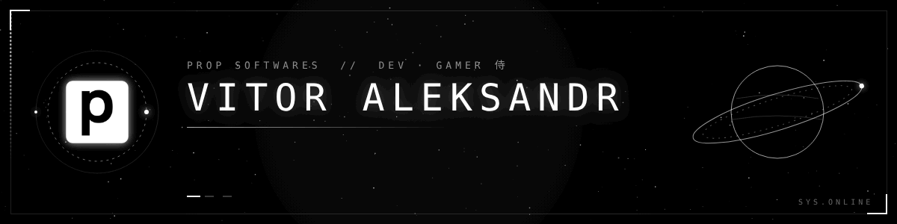

  

<h1 align="center">Vitor Aleksandr</h1>

<strong>Desenvolvimento web · Logística · Automação</strong>

Desenvolvo sistemas web para rotinas de operação, de portais de coleta a ferramentas de controle financeiro. Trabalho com interfaces em React e TypeScript e uso Supabase e PostgreSQL para dar suporte a esses fluxos.

## Projetos em destaque

| Projeto | O que faz |
| :--- | :--- |
| **ELO4 Coletas** | Portal para registrar e acompanhar coletas na operação logística. |
| **ELO4 Financeiro** | Sistema para controle financeiro e consulta de relatórios. |
| [**Pilgrim**](https://github.com/bemtivitor/pilgrim) | Projeto de loja de roupas desenvolvido com Next.js e TypeScript. |
| [**Portfólio**](https://github.com/bemtivitor/portifolio) | Portfólio web com visual inspirado na Steam. |

## Tecnologias

**Interfaces**  

**Dados e ferramentas**  

## Atividade no GitHub

Números do perfil público em 8 nov. 2026. O gráfico de contribuições do GitHub fica disponível abaixo no perfil.
